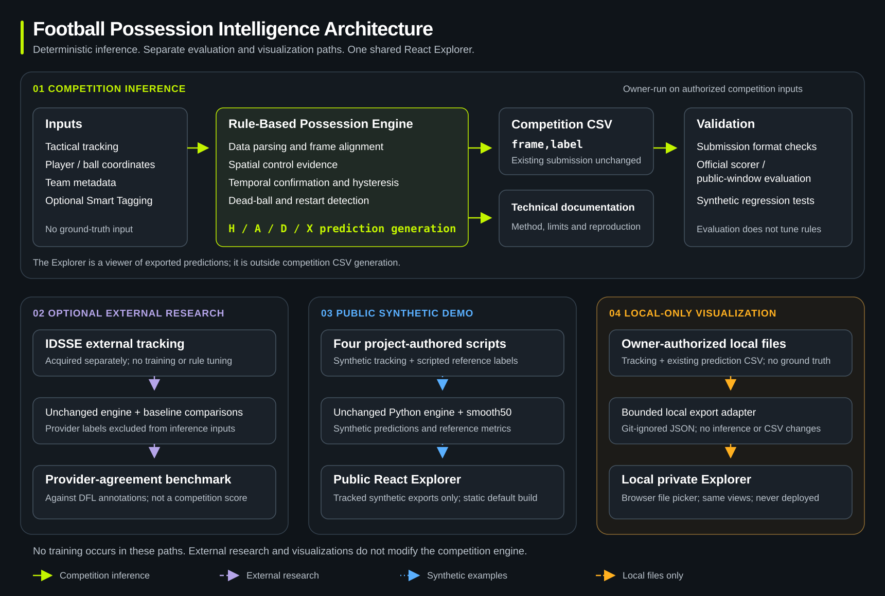

# MAF FC — Football Possession from Tracking

MAF FC's entry to **More than a Hack 2027, Phase 1: Ball Possession**, organised by Metrica Sports,
FC Barcelona Innovation Hub and Mobile World Capital Barcelona.

The **Rule-Based Possession Engine** reads automatic tracking data for a full professional match
(FC Barcelona vs Athletic Club) and labels every one of its 199,319 video frames. It is
deterministic and rule-based: no machine learning, no training data, and identical inputs always
produce identical output. An optional **React Explorer** shows how possession decisions are made.

| Label | Meaning |
|---|---|
| `H` | Home possession |
| `A` | Away possession |
| `D` | Dead ball (play stopped) |
| `X` | No answer (outside the halves, or no possession established yet) |

## Architecture



The competition path (top) is the only one that produces the submitted CSV. External research,
the public synthetic demo and local-only visualization are separate, and none of them trains or
changes the engine.

## How it works

1. **Tracking input:** tactical tracking gives each player's and the ball's position per frame.
   Smart Tagging set pieces are optional extra evidence.
2. **Player–ball control:** a team has control when its nearest player is within 2.0 m of the
   ball and the nearest opponent is at least 1.0 m further away. Merely being nearest is not
   enough.
3. **Temporal confirmation:** possession changes only after 10 control observations, and the
   change is backdated to when control began. Possession is held through passes, loose balls
   and short tracking gaps, so the output does not flicker.
4. **Dead balls and restarts:** the ball leaving the pitch, the time before kickoff and tagged
   set pieces mark stoppages. A detected restart strike starts the next possession. Each half is
   processed independently.
5. **Output:** one `frame,label` row per video frame, UTF-8 with LF line endings.

This matters because the ranking metric, **spellF1**, scores whole possessions rather than
single frames. All nine parameters were fixed in advance from football reasoning, and none was
fitted to the match. The method was developed internally as "Phase 3B"; the public name changes
nothing in the algorithm. Details, parameters and known limitations are in the
**[technical document](docs/TECHNICAL_DOCUMENT.md)**.

## Results

### Official public five-minute window

| Method | spellF1 (ranking) | macroF1 (tie-break) |
|---|---:|---:|
| **Rule-Based Possession Engine** | **0.400000** | **0.597742** |
| Official smooth125 baseline | 0.4242 | 0.5812 |
| Official smooth50 baseline | 0.3256 | 0.6207 |

- **spellF1** is the primary ranking criterion; **macroF1** breaks ties.
- Measured with the organisers' unmodified scorer (commit `f8f2629`) **after** the algorithm was
  frozen. The public ground truth was never used to train, tune or select it.
- The window covers only **7,500 graded frames and 17 reference possession spells**, so it says
  little about the full match. These are not private leaderboard scores or a ranking prediction.

### Separate external study (IDSSE)

On one public match from the IDSSE/DFL dataset, the unchanged engine scored spellF1
**0.3921** / macroF1 **0.6333**, against **0.3011** / **0.3849** for smooth50. This measures
**agreement with the data provider's own annotations on a single match**. It is not a
competition score and not independently verified accuracy, and the data was never used to build
the engine. See the [IDSSE report](docs/IDSSE_BENCHMARK_E1D_B.md).

## React Explorer

One React application with two clearly separated modes. Neither is needed to produce the
competition CSV.

| | Public demo | Local Explorer |
|---|---|---|
| Runs | Any static host (`npm run build`) | Your computer only (`npm run dev:local`), never deployed |
| Data | Four synthetic scenarios written by the team | Your authorized actual-match exports, kept in Git-ignored `.local-explorer/` |
| Predictions | The unchanged Python engines, run on the synthetic scenarios | Your existing engine CSV and, optionally, smooth50 |
| Compare page | Both models against each scenario's **scripted** reference labels | Engine **vs smooth50**: where the predictions agree and differ |
| What scores mean | Illustrative behaviour on invented situations | No accuracy at all: there are no reference labels |

- **Public demo:** contains no competition data, video, ground truth or real predictions. Its
  scenario metrics demonstrate behaviour; they are not competition accuracy.
- **Local Explorer:** opens your registered export by default and lets you switch between
  five-minute match windows. Real frame numbers are shown throughout. Its data loader exists
  only in the local development server, refuses non-local requests, and is absent from every
  public build. Automated privacy tests check this.

The owner has run the local workflow on a 7,500-frame window of the competition match. Other
windows, matches and tracking formats are not all verified. Operating details are in the
**[Explorer README](explorer/README.md)**.

## Quick start

Requires Python 3.10 (Python commands run from the repository root). The Explorer needs Node 22+.

**1. Install the pinned Python dependencies**

```powershell
python -m venv .venv
.\.venv\Scripts\Activate.ps1            # macOS/Linux: source .venv/bin/activate
python -m pip install -r requirements.txt
```

**2. Reproduce the competition predictions** (needs the organisers' data, which is not in this
repository)

```powershell
$env:MTAH_DATA_DIR = "<data-root>"      # folder containing tactical/BAR-ATH_tactical_atd.xml and .txt
python src/possession.py --out outputs/submission.csv
python src/check_submission.py outputs/submission.csv
```

`--data-dir <data-root>` can replace the environment variable (macOS/Linux:
`export MTAH_DATA_DIR=<data-root>`). The run takes one to two minutes and writes 199,319 rows. The
organisers' own validator, [`evaluation/validate_submission.py`](https://github.com/metrica-sports/more-than-a-hack-2027/blob/main/evaluation/validate_submission.py),
can check the file too.

**3. Open the public demo** (synthetic data only, nothing else required)

```powershell
cd explorer
npm ci
npm run dev                             # http://127.0.0.1:5173
```

**4. Explore your own match data locally** (needs step 2's data and predictions)

```powershell
python src/baseline.py --out outputs/baseline_smooth50.csv     # optional: smooth50 for comparison
python tools/export_local_scenario.py `
  --metadata "$env:MTAH_DATA_DIR\tactical\BAR-ATH_tactical_atd.xml" `
  --tracking "$env:MTAH_DATA_DIR\tactical\BAR-ATH_tactical_atd.txt" `
  --predictions outputs/submission.csv `
  --baseline-predictions outputs/baseline_smooth50.csv `
  --start-frame 11185 --frame-count 7500 `
  --out .local-explorer/first-half-000.json --register
cd explorer
npm run dev:local                       # opens the registered window at /explorer and /compare
```

The export is a five-minute window (the first half starts at frame 11185). It stays in the
Git-ignored `.local-explorer/` folder: never commit or share it. For more windows, `--diagnose`
and troubleshooting, see [preparing local data](explorer/README.md#prepare-and-register-authorized-data).

**5. Run the tests** (synthetic fixtures only)

```powershell
python -m pytest tests/test_baseline.py tests/test_possession.py tests/test_game_state.py -q   # engine
python benchmark/setup_official.py      # once: pinned public scorer files, checksum-verified
python -m pytest tests tools -q         # full Python suite
cd explorer; npm test; npm run privacy:test
```

More checks (type check, builds, licence notices, browser smoke tests) are listed under
[Explorer: Run](explorer/README.md#run).

## Repository structure

```text
src/          Rule-Based Possession Engine, Smart Tagging reader, smooth50 baseline, format checker
tests/        synthetic tests for the engine and the optional benchmark adapters
tools/        synthetic scenario exporter, local Explorer exporter, vendored official scorer
explorer/     React Explorer: public synthetic demo and local-only mode
benchmark/    optional external benchmark adapters (IDSSE, SkillCorner) and scorer setup
docs/         technical document, research reports, architecture diagram, archive
```

## Data, privacy and rules

- **Competition data is never in Git.** The organisers' match files, every prediction derived
  from them and local Explorer exports are excluded by [`.gitignore`](.gitignore) and must
  never be published.
- **Public demo data is synthetic.** The four scenarios' tracking and reference labels are
  scripted in [`tools/export_scenarios.py`](tools/export_scenarios.py), and their predictions
  come from the unchanged engines.
- **Comparing predictions is not evaluation.** Local engine-vs-smooth50 agreement says where two
  models differ, not which one is right.
- **Competition rules followed:** no hand labelling, no checking against the match video, and
  no training or tuning on the match or its ground truth. See the organisers'
  [official repository](https://github.com/metrica-sports/more-than-a-hack-2027),
  [rules](https://github.com/metrica-sports/more-than-a-hack-2027/blob/main/RULES.md) and
  [submission requirements](https://github.com/metrica-sports/more-than-a-hack-2027/blob/main/SUBMISSION.md).

## Documentation

- [Technical document](docs/TECHNICAL_DOCUMENT.md): method, parameters, testing, limitations
- [Explorer README](explorer/README.md): pages, both modes, local exporter, privacy checks, scenario provenance
- [Architecture diagram](docs/assets/possession-architecture.svg) and [image inventory](docs/assets/ASSET_INVENTORY.md)
- [IDSSE benchmark report](docs/IDSSE_BENCHMARK_E1D_B.md) and other research notes in [`docs/`](docs/)
- [Archive](docs/archive/): earlier design explorations and the integration manifest

## Licence and credits

- **Our code:** [MIT](LICENSE). The match data is not covered by any licence here.
- **Adapted starter code:** © 2026-2027 Metrica Sports, MIT; full notice in
  [`src/baseline.py`](src/baseline.py). [Vendored scorer notices](tools/vendor/README.md).
- **IDSSE:** CC BY 4.0; credit Deutsche Fußball Liga and Bassek, Rein, Weber and Memmert
  (2025). [Dataset attribution and DOI](docs/IDSSE_BENCHMARK_E1D_B.md#frozen-source-and-protocol).
- **Explorer assets:** team portraits, organiser logos and Motus-derived styling values are
  excluded from MIT. The owner confirms project-specific public use; no independent grant
  documents were inspected. [Rights details](explorer/README.md#owner-confirmed-public-use-permissions).
- **Third-party fonts and build notices:** Inter and Space Grotesk use SIL OFL 1.1;
  [Explorer licensing](explorer/README.md#visual-identity-and-licences) explains the bundled notices.
